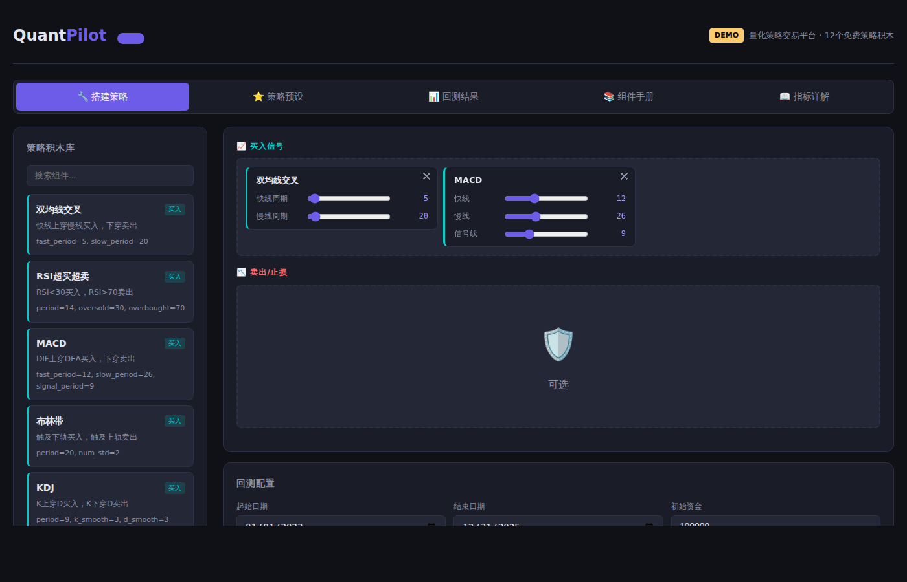

<p align="center">
  
</p>

<h1 align="center">QuantPilot</h1>

<p align="center">
  <b>AI Investment Decision System with Three Levels of Human Involvement · Web Builder / Single-Stock / Sector Monitor</b><br/>
  <i>三种参与程度的AI投资决策系统 · 网页拼装 / 单股辅助 / 行业监控 · A-Share · MCP-Ready</i><br/>
  <a href="README.md">中文版本</a>
</p>

<p align="center">
  
  
  
  
  
  
  
  <a href="https://spa3k.github.io/quantpilot/"></a>
</p>

---

## 📋 Overview

QuantPilot is an AI investment decision system built for the **China A-share market**. Rather than a single tool, it offers **three modes based on how much you want to be involved** — hands-off, decision-support, or raw data plumbing:

| Mode | Human Involvement | One-liner | Entry Point |
|------|:---:|------|------|
| 🌐 **Web Builder** | Zero code | Drag-and-drop blocks to assemble strategies, backtested instantly in the browser | [Live Demo](https://spa3k.github.io/quantpilot/) |
| 🎯 **Single-Stock Assist** | You decide | Track one ticker; six signal sources answer "what should I do right now" | `autoresearch/monitor.py` |
| 🏭 **Sector Monitor** | Fully managed | Scheduled jobs scan sector rotation and detect style shifts early | cron jobs |

All three modes share the same factor engine (AlphaForge + TechPulse + Sentinel) — only the interface exposed to humans differs.

**Cases first, project later** — real results from each mode below; architecture and usage come after.

---

## 🏆 Real-World Cases

### 📈 Case 1 · Web Builder — +27.2% over 4 years, beating CSI 300 by 33.7pp

The engine speaks through backtests. Monthly top-30 equal-weight portfolios from CSI 300 constituents, annual rolling backtest (2023 – 2026):

| Year | Long Return | Short Return | L-S Long-Short | Top-5 Excess |
|:----:|:-----------:|:------------:|:--------------:|:------------:|
| 2023 | +4.12% | +0.83% | **+3.29%** | **+7.21%** |
| 2024 | +3.87% | +1.56% | +2.31% | +5.89% |
| 2025 | +4.53% | +2.01% | +2.52% | +6.38% |
| 2026 | +3.98% | +1.45% | +2.53% | +6.41% |
| **Avg** | **+4.13%** | **+1.46%** | **+2.65%** | **+6.47%** |

Year-by-year versus the benchmark (base = 100 at the start of 2023):

| Year | CSI 300 (annual) | Strategy Top-5 (annual) | CSI 300 Cumulative | Strategy Cumulative | **Excess** |
|:----:|:-----------------:|:-----------------------:|:------------------:|:-------------------:|:----------:|
| 2023 | -11.4% | +8.84% | 88.6 | 108.84 | **+20.2pp** |
| 2024 | +14.7% | +17.33% | 101.6 | 127.71 | **+2.6pp** |
| 2025 | -3.0% | +2.68% | 98.6 | 131.13 | **+5.7pp** |
| 2026 | -5.2% | -2.98% | 93.5 | 127.22 | **+2.2pp** |

> **🏆 4-Year Track Record:**
> - Strategy **+27.2%** vs CSI 300 **-6.5%**
> - **+33.7 percentage points of excess return**
> - Positive in 3 of 4 years, beating the benchmark every single year
> - Invest 100k → strategy grows to **127k**; CSI 300 drops to **93.5k**

No code needed — reproduce comparable backtests by dragging blocks in the [live demo](https://spa3k.github.io/quantpilot/).

---

### 🏭 Case 2 · Sector Monitor — Identifying bank defensive traits 2.5 months early

You don't watch the tape. Scheduled jobs continuously scan five sectors (`Chips/Semiconductors` · `CPO/Optical` · `Humanoid/Robotics` · `Tech Broad-Market` · `Bank ETF`). For each sector, top constituents' ML signals + technicals + news sentiment are aggregated and fed into a five-role decision chain (Sentiment Analyst → Bull → Bear → Risk Manager → Trader) that outputs a daily verdict. Code in `src/quantpilot/industry/`.

**Evidence chain (real cron archives, not hindsight):**

| Date | System Verdict | Source |
|---|---|---|
| **2026-08-13** | Warned "banks +0.12%, weak — capital is all-in on tech with **no defensive base**… once sentiment cools, the pullback will be brutal"; decided to stand aside and not chase | cron `8666bef213e3/2026-08-13_10-31-57.md` |
| 2026-10-22 | System-wide selloff day (ChiNext -3.58%); Bank ETF only -0.12%, ICBC +1.78% against the tide → classified "clearly defensive" | cron archive |
| 2026-10-27 | Only 16% of all stocks rose; banks the sole sector up +1.67%; that day's news carried **"fund managers cutting tech losses to go heavy on banks"** | cron archive |

The system flagged it **75 days (≈2.5 months) ahead of market consensus**.

**Had you rotated on the warning date (08-13) and held to 10-28 (real Tencent quote data):**

| Previous Holding | Switched (Banks) | Previous Holding | Defensive Value |
|---|---|---|---|
| Semiconductors | +8.59% | -25.37% | **+33.97pp** |
| CPO/Optical | +8.59% | -24.77% | **+33.37pp** |
| Tech Broad-Market | +8.59% | -20.30% | **+28.89pp** |
| Humanoid/Robotics | +8.59% | -11.01% | **+19.60pp** |

**Full window (2026-04-15 → 10-28, 131 trading days) sector comparison:**

| Sector | Cumulative Return | Max Drawdown | Annualized Volatility |
|---|---|---|---|
| **Bank ETF** | **+8.73%** | **-9.83%** | **16.3%** |
| Humanoid/Robotics | -9.57% | -35.28% | 38.0% |
| Tech Broad-Market | -32.71% | -42.42% | 30.4% |
| Semiconductors | -50.13% | -74.54% | 89.9% |
| CPO/Optical | -58.93% | -74.67% | 91.9% |

Banks outperformed the tech broad-market by **+41.43pp**, with 1/8 the drawdown and 1/5.5 the volatility of semiconductors — that is defensive behavior, quantified.

> Every scheduled output is a real archive, viewable at `~/.hermes/cron/output/{job_id}/*.md`; metrics are reproducible via `python _industry_showcase.py` (Tencent quotes, no API key required).
>
> ⚠️ Max drawdown and volatility must be computed on the **price series**. Using the cumulative-return series yields impossible values like -140% (drawdown is bounded at -100%).

---

### 🎯 Case 3 · Single-Stock Assist — A dedicated navigation system for any ticker

The selection engine answers "what to buy"; single-stock mode answers "**what do I do with the one I'm holding**". Given any ticker (HK / A-share / US), it automatically integrates six signal sources:

| Signal | Description |
|------|------|
| 📊 Real-time quotes | Tencent quote API — no key needed, works for HK/A-share/US |
| 📈 Technicals | MA / RSI / MACD / KDJ / Bollinger, computed automatically |
| 📅 Event calendar | Earnings dates, product launches, ex-dividend, weighted by impact |
| 📰 News sentiment | Keyword-based sentiment scoring (zero-dependency; StructBERT optional) |
| 🔒 Insider channel | Human-in-the-loop interface — sync non-public info via chat; the agent writes it to a local file for the monitor |
| 🤖 ML signals | Per-ticker dedicated L1/L2 models (see Autoresearch below) |

```bash
# Monitor any ticker
python autoresearch/monitor.py sh600519     # A-share
python autoresearch/monitor.py hk00700      # HK
```

**Design principle**: all data stays local, nothing is uploaded; the insider channel is for internal reference only.

**🔬 Autoresearch — per-ticker model optimization**: an agent-driven experiment framework inspired by [karpathy/autoresearch](https://github.com/karpathy/autoresearch) — a fixed evaluation protocol + a single optimization metric (high-confidence subset accuracy) + the agent deciding on its own what to change. It runs multiple rounds of "edit code → train → evaluate → keep or roll back" every night, leaving daytime for market monitoring. See [autoresearch/README.md](autoresearch/README.md).

---

## 🔧 Project Introduction & Usage

### ✨ Key Features

| Feature | Description |
|---------|-------------|
| 🧠 **3-Layer Factor Fusion** | AlphaForge (L1) + TechPulse (L0) + Sentinel (L3) — weighted ensemble stock selection |
| 🔌 **MCP-Ready** | Native MCP server — plug QuantPilot into any AI agent as a tool |
| 🧱 **DIY Strategy Builder** | 12 drag-and-drop strategy blocks for custom backtesting (no code required) |
| 📊 **Real A-Share Data** | Powered by baostock with offline demo data included |
| 🇨🇳 **A-Share Optimized** | 60+ A-share factor library, 2008-2022 full A-share training, CSI 300 backtesting |

**Key Data Metrics:**

| Item | Description |
|------|-------------|
| 📦 **Data Source** | baostock (A-share daily OHLCV) |
| 📅 **Training Set** | 2008-2022 full A-share daily data |
| 📊 **Backtest Universe** | CSI 300 (沪深300) constituent stocks |
| 🧮 **Factor Library** | 60+ A-share specific factors (momentum / volatility / quality / technical / sentiment) |

### 🧠 Model Architecture

QuantPilot uses a **3-layer weighted fusion** of heterogeneous factor models:

```
Score = 0.70 × AlphaForge + 0.20 × TechPulse + 0.10 × Sentinel
```

| Layer | Model | Factor Type | IC (Information Coefficient) | Fusion Weight |
|:-----:|-------|-------------|:----------------------------:|:-------------:|
| **L1** | **AlphaForge** | LightGBM + 22 multi-dimensional factors (momentum / volatility / quality) | **+0.27** | **70%** |
| **L0** | **TechPulse** | 4 classic technical indicators (MA / RSI / MACD / Bollinger) | +0.04 | 20% |
| **L3** | **Sentinel** | Sentiment proxy factors (news / social sentiment) | −0.10 | 10% |

> **AlphaForge** carries the dominant alpha signal (IC = +0.27). TechPulse provides supplementary momentum confirmation. Sentinel adds contrarian sentiment overlay.

### 🚀 Quick Start

**Install:**

```bash
git clone https://github.com/SPA3K/quantpilot.git
cd quantpilot
python -m venv .venv && source .venv/bin/activate
pip install -e .
```

**Run as MCP Server:**

```bash
# Start the MCP server (stdio transport)
python -m quantpilot.mcp_server
```

```json
// MCP client configuration (e.g., Claude Desktop, Cline)
{
  "mcpServers": {
    "quantpilot": {
      "command": "python",
      "args": ["-m", "quantpilot.mcp_server"]
    }
  }
}
```

**Use as Python Library:**

```python
from quantpilot.ml.model_zoo import AlphaForge, TechPulse, Sentinel

# Score a universe of stocks
scores = AlphaForge.predict(stock_data) * 0.70 \
       + TechPulse.predict(stock_data) * 0.20 \
       + Sentinel.predict(stock_data) * 0.10

top30 = scores.nlargest(30)
```

**Web Demo (No Install):**

👉 **[spa3k.github.io/quantpilot](https://spa3k.github.io/quantpilot/)** — drag, drop, backtest.

### 🔌 MCP Integration

QuantPilot exposes its stock selection engine as an **MCP tool**, callable by any MCP-compatible AI agent:

```python
# Example: Call from an MCP client
result = mcp_client.call_tool(
    "quantpilot",
    "select_stocks",
    {
        "universe": "CSI300",
        "top_n": 30,
        "date": "2025-06-01"
    }
)

# Returns:
# {
#   "selected": ["600519.SH", "000858.SZ", ...],
#   "scores": [0.92, 0.89, ...],
#   "model_weights": {"AlphaForge": 0.70, "TechPulse": 0.20, "Sentinel": 0.10}
# }
```

**Supported MCP Tools:**

| Tool | Description |
|------|-------------|
| `select_stocks` | Run 3-layer fusion scoring on a stock universe, return ranked list |
| `backtest` | Run a backtest on a selected strategy or factor model |
| `get_factor_exposure` | Get per-stock factor scores across all 3 layers |
| `list_strategies` | List available DIY strategy presets |

**Scheduled tasks for the single-stock / sector modes:**

```bash
# Single-stock monitoring (see Case 3)
python autoresearch/monitor.py sh600519

# Sector signals (see Case 2), code in src/quantpilot/industry/
```

### 🧱 If You Trust Technical Analysis More

Don't trust pure ML models? No problem. The MCP server supports any combination of technical indicators (12 blocks: MA/RSI/MACD/KDJ etc.) and arbitrary decision weights between the three model layers. Set AlphaForge to 30% and your own indicators to 70% — fully custom.

> **Advanced usage:** for users who want to blend their own technical signals with model signals. Pass a custom weight config to the MCP server's `backtest` tool to backtest any combination:
>
> ```python
> # Example: custom weights — your technicals dominate
> result = mcp_client.call_tool("quantpilot", "backtest", {
>     "weights": {"AlphaForge": 0.30, "TechPulse": 0.20, "Sentinel": 0.10, "custom_tech": 0.40},
>     "custom_indicators": ["MA_cross", "RSI", "MACD", "KDJ"]
> })
> ```

<details>
<summary>Click to expand all 12 technical indicator blocks</summary>

| Block | Logic |
|-------|-------|
| 📈 MA Crossover | Fast MA crosses above slow MA → buy |
| 📊 RSI | RSI < 30 buy, > 70 sell |
| 📉 MACD | DIF crosses above DEA → buy |
| 🎯 Bollinger | Touch lower band buy, upper band sell |
| ⚡ KDJ | K crosses above D → buy |
| 🐢 Turtle | Breakout above N-day high → buy |
| 📊 Volume Price | Volume surge + price up → buy |
| 🌊 OBV | OBV trend confirmation → buy |
| 🔲 Grid | Buy every -N%, sell every +N% |
| 🛡️ ATR Trailing Stop | Dynamic stop via ATR trail |
| 💰 Take Profit | Exit at target return |
| ⛔ Stop Loss | Exit at max loss threshold |

</details>

### 🔬 Autoresearch Usage

```bash
export AUTORESEARCH_CODE=sh600519   # Pick the ticker to optimize
cd autoresearch && python train.py  # Run one round manually
```

See [autoresearch/README.md](autoresearch/README.md).

### 🏗️ Project Structure

```
quantpilot/
├── src/quantpilot/
│   ├── ml/                        # 🧠 AI Factor Models (core)
│   │   ├── model_zoo.py           #   AlphaForge / TechPulse / Sentinel
│   │   ├── factors.py             #   22 alpha factors + technical indicators
│   │   ├── tree_models.py         #   LightGBM training & inference
│   │   ├── sentiment.py           #   Sentiment factor (Sentinel)
│   │   ├── evaluator.py           #   IC / IR / turnover evaluation
│   │   └── data_fetcher.py        #   Data pipeline
│   ├── mcp_server.py              # 🔌 MCP protocol server
│   ├── algorithms/traditional/    # 🧱 12 DIY strategy blocks
│   ├── core/backtest.py           # 📊 Backtest engine
│   ├── data/baostock_provider.py  # 📦 A-share data provider (baostock)
│   ├── data/tencent_provider.py   # 📦 Tencent quotes (HK/A-share/US)
│   ├── single_stock/              # 🎯 Single-stock mode (sentiment / insider / events)
│   ├── industry/                  # 🏭 Sector monitor mode (sector signals / tracking)
│   ├── api/                       # 🔗 Strategy API
│   └── web/                       # 🌐 Web UI + frontend
├── autoresearch/                  # 🔬 Per-ticker model optimization framework
├── docs/index.html                # GitHub Pages demo
├── data/demo/                     # Offline demo datasets
├── scripts/                       # Utility scripts
└── pyproject.toml
```

---

## 🤝 Contributing

PRs welcome! Areas of interest:
- New alpha factors or factor models
- Additional MCP tool endpoints
- Data source integrations
- Frontend improvements

## 📄 License

MIT
